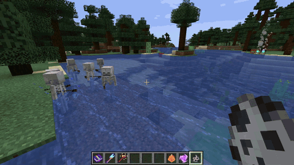

# Velorise's Staves & Elements

  
  <!-- Modrinth (Pending Review): Auto-activates once approved -->
  
  <!-- Modrinth Dynamic Downloads Badge (Uncomment once published):
  
  -->
  
  
  

  
  
  

> **Vanilla-friendly elemental combat staves, element-imbued swords, and a deep Elemental Reaction System powered purely by Durability & Cooldowns.**

  

📖 **Looking for full crafting recipes, exact damage sheets & reaction formulas? Visit the [Official Velorise's Staves Wiki](https://github.com/hungbbdzz/velorise-staves/wiki)!**

---

## Overview

**Velorise's Staves & Elements** brings combo-driven elemental magic to Minecraft without mana bars, bloated spellbooks, or extra dimensions. Craft **13 unique combat staves**, infuse swords in an Anvil, trigger **20 elemental reactions** with mobs and the vanilla environment, and carry up to 4 distinct staff types at once to activate **Elemental Resonances** across **NeoForge 1.21.1**, **Fabric 1.21.1**, and **Forge 1.20.1**.

  &nbsp;&nbsp;
  &nbsp;&nbsp;
  &nbsp;&nbsp;
  &nbsp;&nbsp;
  &nbsp;&nbsp;
  &nbsp;&nbsp;
  &nbsp;&nbsp;&bull;&nbsp;&nbsp;
   
  <b>7 Elements:</b> Pyro &middot; Hydro &middot; Anemo &middot; Electro &middot; Dendro &middot; Cryo &middot; Geo &nbsp;|&nbsp; <b>Omni</b> (Adaptive)

> 💡 *Note: Animated in-game gameplay demos for all reactions and staves are uploaded separately in the **Gallery Tab** and documented thoroughly in the **[Official Wiki](https://github.com/hungbbdzz/velorise-staves/wiki)**.*

---

## Official Documentation & Guides

Explore detailed mechanics, progression steps, and formulas on the GitHub Wiki:

* 📚 **[Elements & Reactions](https://github.com/hungbbdzz/velorise-staves/wiki/Elements-and-Reactions)**: Complete breakdown of all 20 reactions (Vaporize, Melt, Overloaded, Bloom, Hyperbloom, Burgeon, Swirl, etc.), damage equations, and aura duration mechanics.
* ⚔️ **[Staves & Weapons](https://github.com/hungbbdzz/velorise-staves/wiki/Staves-List)**: In-depth stats, cooldowns, reach, and Netherite upgrades for all 13 base staves and the Apex **Omni Staff**.
* 🔨 **[Anvil Weapon Imbuing](https://github.com/hungbbdzz/velorise-staves/wiki/Anvil-Imbuing)**: How to infuse any standard or modded sword with elemental essences for 3 XP levels.
* ⚡ **[Environmental Interactions](https://github.com/hungbbdzz/velorise-staves/wiki/Environmental-Interactions)**: Electrified water physics, temporary ice bridges, Geo pillars, Sculk sensor resonance, and automated **Tesla Coils**.
* 🔮 **[Relics & Utilities](https://github.com/hungbbdzz/velorise-staves/wiki/Relics-and-Utilities)**: Documentation for the Magic Mirror (home recall), Void Translocator (safe directional blink), and Crystallize shield shards.
* ⚙️ **[Configuration Guide](https://github.com/hungbbdzz/velorise-staves/wiki/Configuration-Guide)**: Full reference for server/client configs, mob mutation chances, and cooldown scalers.

---

## Features Summary

### 13 Elemental Combat Staves & Netherite Upgrades
- **Mob & World Identities:** Cast fireballs (`Inferno Rod`, `Ghastfire Staff`), continuous water beams that scale with user Max HP (`Guardian Lens`), freezing orbs (`Frostbolt Wand`), targeted lightning streams (`Arc Caster`), sonic booms (`Resonant Echo`), homing bolts (`Shulker Seeker`), dragon clouds (`Dragonfire Scepter`), wither skulls (`Wither Scepter`), toxic webs (`Webcaster`), wind blasts (`Wind Staff`, backported with Wind Charges to Forge 1.20.1), and defensive taunting constructs (`Evoker Fang Staff`).
- **Omni Staff:** Fires homing crystal orbs that auto-select the optimal reaction against your target's active aura, or press <kbd>R</kbd> / <kbd>Tab</kbd> to open the radial wheel and lock a specific element manually.
- **Vanilla Progression:** Powered by vanilla durability and cooldowns, enchantable with **Elemental Mastery I–III**, repairable in an Anvil with matching Elemental Essences, and upgradeable to **Netherite** via the Smithing Table.

### Elemental Reaction System (EGT)
- **7 Elements (+ Omni):** Pyro, Hydro, Cryo, Electro, and Dendro linger as Auras (`1U–3U` gauges with natural decay and standard ICD), while Anemo and Geo act as universal Triggers.
- **20 Combat Reactions:** Trigger **Vaporize** / **Melt** (`x1.5` / `x2.0`), **Overloaded**, **Superconduct**, **Frozen** & **Shatter**, **Electro-Charged**, **Burning**, **Quicken / Aggravate / Spread**, **Bloom / Hyperbloom / Burgeon** (physical 3D Dendro Cores), **Overvape**, **Swirl**, and **Crystallize** (orbiting elemental shield shards).

### Imbued Swords, Resonances & 4-Staff Cap
- **Element-Imbued Swords:** Combine any sword with an Elemental Essence in an Anvil to apply `1.0U` on full-strength swings (`>= 90%` charge) while keeping existing enchantments.
- **8 Elemental Resonances:** Carry matching element pairs (or 4 distinct elements for *Protective Canopy*) in your inventory for passive combat buffs, balanced by the **4-Staff Cap** (*Arcane Overload*).

### Living Environment & Smart Mob Ecosystem
- **Interactive Blocks & Weather:** Water/rain applies Hydro and conducts Electro; Redstone, Amethyst, Sculk Sensors, and **Tesla Coils** (Lightning Rod atop a Redstone Block) emit Electro arcs; Fire/Magma, Powder Snow, Mushrooms/Slime/Honey, and Pointed Dripstone interact directly with combat.
- **Innate & Mutated Mobs:** Creatures carry natural elemental affinities and resistances (configurable mutation rates in TOML, including dual-element Charged Mutated Creepers) plus pathfinding hazard avoidance (`8.0F` weight) so mobs avoid stepping onto harmful aura blocks unless forced.

### Codex, Artifacts & Compatibility
- **In-Game Guidebook & HUD:** Includes the interactive 9-tab **Elemental Codex** (9 languages), 3D floating damage & reaction popups, overhead aura icons, **JEI** integration, **Jade / WAILA** tooltips, and **11 custom Advancements**.
- **Utility Artifacts:** **Void Translocator** (safe blink teleportation with zero fall damage) and **Magic Mirror** (instant recall to bed/spawn, cross-dimensional on Netherite).

---

## Controls & Crafting Quick Notes

| Input / Station | Action |
| :---: | :--- |
| <kbd>Right-Click</kbd> | Cast Staff, read **Elemental Codex**, or channel Artifacts |
| <kbd>R</kbd> or Hold <kbd>Shift + Right-Click</kbd> | Open **Omni Staff Element Wheel** (select mode or Auto) |
| **Anvil** | Repair Staves, imbue Swords with Elements, or fuse `Staff + Omni Element` |
| **Smithing Table** | Upgrade any Staff or Artifact to **Netherite** tier |

---

## Support the Development

If you enjoy **Velorise's Staves & Elements** and want to support continued development, consider sponsoring via GitHub Sponsors:

  

---

## License & Disclaimer

**All Rights Reserved (Code & Documentation Only)** — Copyright (c) 2026 **hungbbdzz** ([LICENSE](https://github.com/hungbbdzz/velorise-staves/blob/main/LICENSE)).

- You may download and use official unmodified releases for personal gameplay. Do **not** redistribute, reupload, mirror, or modify the mod's source code or binaries without permission.
- **Modpacks:** Modpacks hosted on **CurseForge** or **Modrinth** that link directly to the official project release without rehosting `.jar` files are welcome.
- **Disclaimer:** *Velorise's Staves & Elements* is an unofficial, non-commercial fan-made mod inspired by *Genshin Impact* and is not affiliated with HoYoverse / Cognosphere Pte. Ltd. or Mojang / Microsoft.
