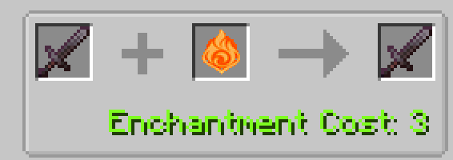
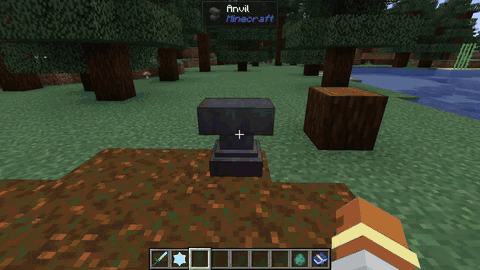

# Anvil Weapon Imbuing

For players who prefer close-quarters melee combat over ranged spellcasting, the **Anvil Imbuing System** allows you to infuse any standard sword (including modded swords) with an elemental essence, empowering your strikes with elemental aura applications.

---

## How to Imbue Swords

Imbuing requires an anvil, an elemental essence, and exactly **3 levels of experience**:

1. Place an **Anvil** and open its interface.
2. Place any sword (Wooden, Stone, Iron, Golden, Diamond, Netherite, or modded SwordItem) in the left slot.
3. Place an **Elemental Essence** (any of the 7 elements, or  Omni Element) in the right slot.
4. Retrieve the imbued sword from the output slot for a base cost of **3 XP levels** (4 XP levels if customized with a new name).

  
   <i>In-Game Anvil UI: Imbuing a Netherite Sword with an elemental essence for 3 XP levels.</i>

---

## Critical Imbuing Rules & Restrictions

* **Full-Strength Strike Requirement:** An imbued sword only applies its elemental aura and reaction effects on **full-strength swings** (when the vanilla attack recharge indicator reaches at least **90% / 0.9F**). Rapid spam-clicking does not discharge the elemental aura.
* **Fire Aspect Enchantment Conflict:** A sword that already carries the vanilla `Fire Aspect` enchantment **cannot** be imbued with non-Pyro elements (Hydro, Cryo, Electro, Dendro, Anemo, Geo, or Omni). The anvil interface will strictly reject the combination. Fire Aspect swords can only be imbued with Pyro.
* **Omni-Imbued Weapon Intelligence:** When a sword is imbued with an **Omni Element**, it dynamically scans the target on every full-strength hit and automatically selects the optimal counter-element to trigger the highest-value reaction (e.g. choosing Pyro if the target is wet to trigger Vaporize, or choosing Cryo if the target is wet to trigger Frozen).

---

## Elemental Properties on Full Melee Strikes

| Blade Infusion | Applied Aura | On-Hit Combat Behavior |
| :--- | :---: | :--- |
| **Pyro Blade** |  Pyro (1.0U) | Ignites targets for 4 seconds. Striking a wet enemy triggers a **1.5x Reverse Vaporize** reaction, multiplying physical melee damage. |
| **Cryo Blade** |  Cryo (1.0U) | Applies Cryo aura and slows targets. Striking an entity standing in water or rain **freezes them solid** immediately. |
| **Electro Blade** |  Electro (1.0U) | Delivers a 1.0U Electro charge. Striking wet targets triggers Electro-Charged arcs that chain to all nearby wet mobs. |
| **Dendro Blade** |  Dendro (1.0U) | Applies Dendro aura on hit. Striking a wet enemy immediately spawns a **Dendro Core** on the ground. |
| **Hydro Blade** |  Hydro (1.0U) | Inflicts the 1.0U Wet status on targets, priming them for follow-up elemental spells or allied attacks. |
| **Anemo Blade** |  Anemo (1.0U) | Executes an Anemo slash that triggers Swirl on existing auras, spreading them to all surrounding entities. |
| **Geo Blade** |  Geo (1.0U) | Triggers **Shatter** against frozen targets for heavy bonus physical damage, and drops Crystallize shield shards. |
| **Omni Blade** |  Omni (1.0U) | Dynamically chooses the strongest reaction element against the target's current state on every single swing. |

---

## In-Game Demonstration

The following clip illustrates imbuing a sword with **Cryo Element** at an anvil for 3 XP levels, then striking a zombie wading in water to trigger an immediate freeze:

  

