# Elements & Elemental Reactions

The combat mechanics of **Velorise's Staves & Elements** are governed by a specialized **Elemental Gauge Theory (EGT)** engine. When an entity is struck by an elemental spell or an imbued melee weapon, an **Aura** measured in Gauge Units (U) is applied to the target. Applying another element while an aura is active triggers an **Elemental Reaction**.

---

## The 8 Elements

<div align="center">
  <table>
    <tr>
      <td align="center"><br/><b>Pyro</b></td>
      <td align="center"><br/><b>Hydro</b></td>
      <td align="center"><br/><b>Cryo</b></td>
      <td align="center"><br/><b>Electro</b></td>
      <td align="center"><br/><b>Dendro</b></td>
      <td align="center"><br/><b>Anemo</b></td>
      <td align="center"><br/><b>Geo</b></td>
      <td align="center"><br/><b>Omni</b></td>
    </tr>
  </table>
</div>

* **Pyro:** Fire-based destructive energy that ignites entities, burns foliage, and triggers Vaporize, Melt, and Burgeon.
* **Hydro:** Water-based energy that wets targets and provides the foundation for Vaporize, Frozen, Electro-Charged, and Bloom.
* **Cryo:** Frost energy that slows movement, turns surface water into temporary frost, and freezes wet targets solid.
* **Electro:** High-voltage lightning energy that paralyzes targets, conducts through water bodies, and activates Dendro Cores into Hyperbloom missiles.
* **Dendro:** Organic vitality that germinates explosive botanical cores when interacting with water.
* **Anemo:** Kinetic vortex energy that pulls entities together and swirls existing auras outward to nearby targets.
* **Geo:** Earth energy that forms protective crystalline shields, summons solid pillars, and shatters frozen entities.
* **Omni:** Primordial essence capable of cycling dynamically through all elemental forms.

---

## Multiplicative Reactions

Multiplicative reactions scale directly with the trigger attack's base damage, multiplying the final damage dealt by a fixed ratio.

| Reaction | Trigger Combination | Damage Multiplier | Aura Consumption | Mechanism |
| :--- | :--- | :---: | :---: | :--- |
| **Forward Vaporize** | Hydro applied to an active Pyro aura | **2.0x (200%)** | 2.0x Gauge | Douses the flame in a violent steam eruption, consuming the underlying Pyro aura completely. |
| **Reverse Vaporize** | Pyro applied to an active Hydro aura | **1.5x (150%)** | 0.5x Gauge | Flash-boils the target while consuming only half the underlying Hydro aura gauge. |
| **Forward Melt** | Pyro applied to an active Cryo aura | **2.0x (200%)** | 2.0x Gauge | Rapidly liquefies the ice layer, resulting in extreme thermal shock damage. |
| **Reverse Melt** | Cryo applied to an active Pyro aura | **1.5x (150%)** | 0.5x Gauge | Extinguishes the flame gradually under chilling frost. |

<div align="center">
  <table>
    <tr>
      <td align="center"><b>Vaporize Reaction</b><br/></td>
      <td align="center"><b>Forward Melt Reaction</b><br/>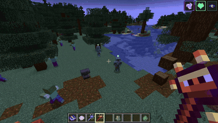</td>
    </tr>
  </table>
</div>

---

## Transformative & Crowd Control Reactions

| Reaction | Elements Involved | In-Game Effect |
| :--- | :--- | :--- |
| **Frozen** | Hydro + Cryo | Completely immobilizes the target in an ice block for several seconds. Mobs cannot move, turn, or attack while frozen. |
| **Shatter** | Heavy Melee / Geo hit on a Frozen target | Breaches the ice block prematurely, dealing heavy blunt physical damage scaling with weapon mass and tier. |
| **Electro-Charged** | Hydro + Electro | Electrifies the wet target, dealing continuous lightning damage over time while arcing electrical bolts to all nearby wet entities. Both auras co-exist on the target. |
| **Overloaded** | Pyro + Electro | Triggers a localized explosive detonation that deals Pyro damage and knocks light entities backwards, interrupting attacks. |
| **Superconduct** | Cryo + Electro | Causes a localized frost explosion that inflicts **-40% Physical Resistance Shred** on the target for several seconds, significantly boosting sword damage. |
| **Burning** | Pyro + Dendro | Ignites a persistent botanical fire that burns the entity continuously until the Dendro aura is consumed. |
| **Swirl** | Anemo + (Pyro / Hydro / Cryo / Electro) | Absorbs the target's active elemental aura and expels it outward in an expanding vortex, propagating the aura to all surrounding enemies. |
| **Crystallize** | Geo + (Pyro / Hydro / Cryo / Electro) | Dislodges an **Elemental Crystallize Shard** upon impact. Walking over the shard equips a protective elemental barrier matching the reacted element. |
| **Overvape** | Pyro on (Hydro & Electro co-existing aura) | Simultaneously triggers both Vaporize and Overloaded in a single devastating explosion. |

<div align="center">
  <table>
    <tr>
      <td align="center"><b>Electro-Charged</b><br/></td>
      <td align="center"><b>Overloaded Explosion</b><br/>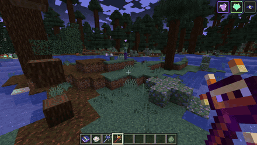</td>
    </tr>
    <tr>
      <td align="center"><b>Swirl Vortex (AoE Aura Spread)</b><br/>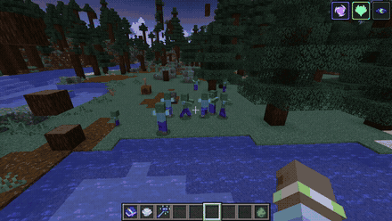</td>
      <td align="center"><b>Geo Crystallize (Elemental Shield Shards)</b><br/>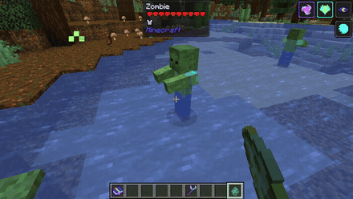</td>
    </tr>
  </table>
</div>

---

## Dendro Reaction System

Dendro reactions center around the production and manipulation of **Dendro Cores**:

```
                  ┌──(Hydro)──> [ Dendro Core Entity ]
                  │                     │
[Dendro Target] ──┤                     ├──(Electro)──> Hyperbloom (Homing missile)
                  │                     │
                  │                     └──(Pyro)─────> Burgeon (High AOE explosion)
                  │
                  └──(Electro)─> [ Quicken State ] ──┬──(Electro)──> Aggravate (+Flat Electro)
                                                      └──(Dendro)───> Spread (+Flat Dendro)
```

* **Bloom:** When Hydro meets Dendro, a botanical **Dendro Core** drops onto the ground. If left untouched, the core detonates after 6 seconds, dealing moderate area-of-effect Dendro damage.
* **Hyperbloom:** Striking an existing Dendro Core with an Electro attack transforms it into a high-speed tracking projectile that locks onto the nearest hostile mob.
* **Burgeon:** Striking an existing Dendro Core with a Pyro attack triggers an instantaneous fiery explosion that inflicts heavy area-of-effect damage without damaging environmental terrain.
* **Quicken, Aggravate & Spread:** Applying Electro to a Dendro-afflicted target places the entity into a vulnerable **Quicken** state. Subsequent Electro attacks trigger **Aggravate** (added flat damage), while subsequent Dendro attacks trigger **Spread** (amplified Dendro burst).

<div align="center">
  <table>
    <tr>
      <td align="center"><b>Bloom (Creation)</b><br/></td>
      <td align="center"><b>Hyperbloom (Electro)</b><br/></td>
      <td align="center"><b>Burgeon (Pyro)</b><br/>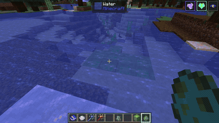</td>
    </tr>
  </table>
</div>

---

## Internal Cooldown (ICD) System

Velorise's Staves & Elements features a high-fidelity **Internal Cooldown (ICD)** engine faithfully adapted from *Genshin Impact*, ensuring combat remains strategic, balanced, and rewarding without degenerate damage spamming or one-tick instakills.

The system is separated into two distinct, independently tracked layers:

### 1. Standard Aura ICD (The 3-Hit / 2.5s Rule)
When repeatedly attacking a target with the same element (e.g. rapid basic attacks or continuous multi-strikes):
* **Hit 1**: Successfully applies elemental aura (or triggers reaction).
* **Hits 2 & 3**: Deal full base weapon/spell damage, but **do not** apply aura or trigger reactions.
* **Hit 4**: Resets the counter and applies aura again.
* **Timer Reset**: If **2.5 seconds (50 ticks)** elapse since the first hit, the counter resets back to 1.

> [!NOTE]
> Aura ICD is tracked per unique combination of **`Attacker + Target Entity + Element Type`**. Switching to a different element (e.g., Pyro then Hydro) or alternating players always applies immediately without waiting for the previous element's cooldown! Certain environmental effects (e.g. lingering cloud hazards) explicitly bypass this rule (`applyElementBypassIcd`).

### 2. Reaction Damage & Trigger ICD
To prevent multiple projectiles or simultaneous procs from detonating dozens of reactions on the same tick, every elemental reaction enforces its own target-specific trigger cooldown:

| Elemental Reaction | Cooldown (Ticks) | Cooldown (Seconds) | Behavior & Notes |
|:---|:---:|:---:|:---|
| **Aggravate / Spread** | `5 ticks` | **0.25s** | High-cadence additive flat damage amplification on Quicken aura |
| **Forward / Reverse Melt** | `8 ticks` | **0.40s** | Multiplicative damage scaling window |
| **Forward / Reverse Vaporize** | `8 ticks` | **0.40s** | Multiplicative damage scaling window |
| **Overloaded** | `10 ticks` | **0.50s** | AoE explosive blast & knockback |
| **Superconduct** | `10 ticks` | **0.50s** | AoE Cryo burst & physical resistance shred (-40%) |
| **Swirl** | `10 ticks` | **0.50s** | Elemental absorption vortex & AoE cross-application |
| **Shatter** | `10 ticks` | **0.50s** | Heavy physical burst upon breaking Frozen status |
| **Electro-Charged** | `10 ticks` | **0.50s** | Periodic continuous shock tick rate |
| **Bloom / Hyperbloom / Burgeon**| `10 ticks` | **0.50s** | Dendro Core generation & detonation throttle |
| **Frozen** | `10 ticks` | **0.50s** | Re-freeze lockout prevention |
| **Crystallize** | `20 ticks` | **1.00s** | Matches Genshin's elemental shield shard drop cadence |
| **Burning** | `40 ticks` | **2.00s** | Tick interval for sustained Pyro DoT re-application |

### 3. Minecraft i-Frame (`invulnerableTime`) Bypass
In vanilla Minecraft, attacking an entity grants it **10 ticks (0.5s) of damage immunity** (`invulnerableTime = 10`), which routinely swallows fast combos and multi-element spells from traditional magic mods. 

Velorise's Staves engine intelligently synchronizes and zeroes out `invulnerableTime = 0` during valid reaction triggers, ensuring rapid combo play (e.g., applying Hydro then immediately striking with Cryo or Pyro) connects seamlessly as intended.

---

## Elemental Resonance System

Carrying matching elemental weapons unlocks passive team-wide buffs known as **Elemental Resonances**, faithfully adapted from *Genshin Impact*. Up to **2 distinct resonances** can be active simultaneously.

<div align="center">
  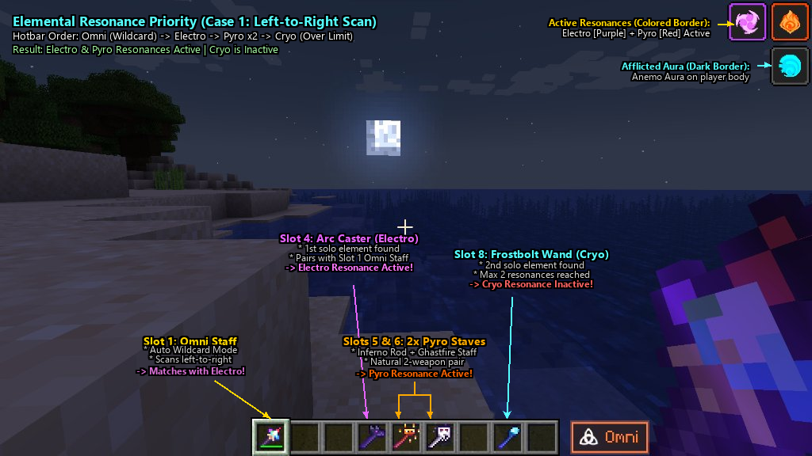
  <br/><sub><i>Case 1: Omni Staff auto-matches with the 1st solo element found (Slot 4: Arc Caster ➔ Electro Resonance). Slots 5 & 6 pair for Pyro Resonance. Slot 8 (Cryo) is inactive.</i></sub>
</div>

### Understanding the Top-Right HUD
When playing with Velorise's Staves, the top-right corner of your screen dynamically tracks your active elemental state:
* 🔲 **Colored Element Border (Viền màu nguyên tố):** Indicates an **Active Elemental Resonance** granting continuous passive combat buffs (e.g. Purple = Electro Resonance, Orange/Red = Pyro Resonance, Cyan = Cryo Resonance).
* ⬛ **Dark / No Border (Viền tối không viền):** Indicates an **Afflicted Elemental Aura currently on your player's body** (e.g. Cyan Anemo, Blue Hydro, Violet Electro). Be mindful of incoming elemental attacks to avoid triggering hazardous self-reactions!

### Slot Priority & Omni Staff Wildcard Pairing
The resonance engine evaluates your inventory in strict sequential order:  
`Mainhand ➔ Offhand ➔ Hotbar (Slots 1–9) ➔ Main Inventory (Slots 10–36)`

1. **Natural 2-Weapon Pairs:** Having 2 distinct weapons of the same element (e.g., Inferno Rod + Ghastfire Staff) automatically activates that element's resonance.
2. **Omni Staff Wildcard:** In Auto mode, the Omni Staff scans your inventory from left to right and dynamically pairs with the **first solo element** that does not already have an active resonance.
3. **Resonance Reordering:** By simply rearranging weapons in your hotbar, you can switch which resonance is active on the fly!

<div align="center">
  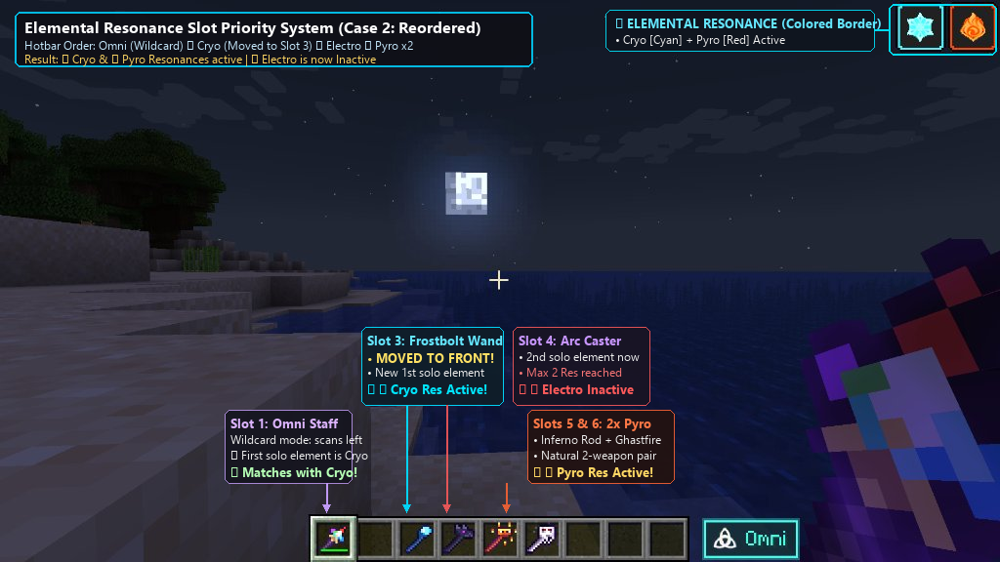
  <br/><sub><i>Case 2: Reordering hotbar slots. Moving Frostbolt Wand (Cryo) to Slot 3 causes Omni Staff to pair with Cryo first, instantly switching your active resonance from Electro to Cryo!</i></sub>
</div>

---

## Arcane Overload (Staff Inventory Limit)

To maintain survival balance and prevent players from becoming god-like one-man armories carrying an entire elemental pantheon at once, carrying more than **4 distinct Arcane Staves** in Survival mode triggers **Arcane Overload**:

<div align="center">
  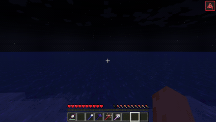
  <br/><sub><i>Exceeding the 4-staff inventory limit triggers Arcane Overload, displaying a red Triquetra warning icon and completely disabling all staff casting.</i></sub>
</div>

* **Overload Penalties:**
  * ❌ **All staff casting is disabled** (right-clicking discharges zero magic).
  * ❌ **All active Elemental Resonances are suppressed.**
  * ⚠️ A prominent red warning badge appears on your HUD and Inventory screen.
* **Overload Rules:**
  * Carrying duplicate backup copies of the same staff type only counts as 1 distinct staff toward the cap.
  * Items stored inside backpacks, Shulker Boxes, or Ender Chests do **not** count toward the cap.
  * Creative and Spectator mode players are completely exempt (`isOverloadExempt`).
  * Server administrators can adjust or disable this cap in `velorise_staves-common.toml` (`max_staves_in_inventory = 0` to remove the limit).

---

## Innate Elemental Mobs & Rare Omni Mutations

The world of Minecraft is populated by creatures that naturally channel volatile primal energies:

<div align="center">
  <table>
    <tr>
      <td align="center"><b>Natural Innate Aura (Blaze)</b><br/>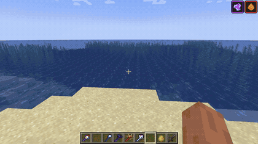<br/><sub><i>Blazes inherently carry a permanent Pyro aura. Striking them with Hydro triggers immediate Vaporize.</i></sub></td>
      <td align="center"><b>Rare Omni Mutation (Magic Immune)</b><br/>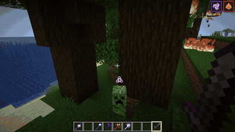<br/><sub><i>Omni-mutated mobs are 100% immune to all 7 magical elements, but highly vulnerable to physical strikes!</i></sub></td>
    </tr>
  </table>
</div>

### 1. Natural Innate Mobs
Certain mobs permanently carry innate elemental auras without requiring prior player attacks:
* **Pyro:** Blazes, Magma Cubes, Ghasts.
* **Hydro:** Drowned, Guardians, Elder Guardians.
* **Cryo:** Strays, Snow Golems.
* **Electro:** Shulkers, Powered Creepers, Endermites.
* **Anemo:** Breezes.
* **Dendro:** Bogged.

### 2. Hostile Mob Mutations
Every newly spawned hostile mob has an innate **7% chance** (`innate_mutation_chance = 0.07`) to mutate into an elemental variant. Mutated mobs glow with elemental particles and drop their corresponding **Elemental Essence** upon defeat.

### 3. The Omni Mutation (Primal Magic Immunity)
Approximately 1 in 7 mutated mobs spawn with the legendary **Omni Mutation** (visible via a hovering Triquetra icon above their head):
* 🛡️ **Total Magic Immunity:** 100% immune to all 7 elemental forms of damage (Pyro, Hydro, Cryo, Electro, Dendro, Anemo, Geo). Magic projectiles and elemental spells deal zero damage.
* ⚔️ **Physical Vulnerability:** Omni mobs possess no defense against raw physical force. Standard swords, bows, crossbows, tridents, and axes deal normal (or amplified) physical damage, making weapon choice crucial!
* 💎 **Guaranteed Rare Drop:** Defeating an Omni mob has a **25% chance** to drop the coveted **Omni Element**!

---

## Vanilla Mechanics Synergy (Potions, Arrows & Tridents)

Velorise's Staves seamlessly integrates vanilla Minecraft combat items into the Elemental Gauge Theory engine, allowing archers and alchemists to participate fully in elemental combos:

<div align="center">
  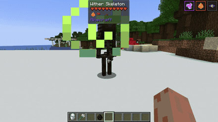
  <br/><sub><i>Vanilla Tridents inherently channel Hydro properties, applying a 1.0U Hydro aura upon striking targets and triggering elemental reactions.</i></sub>
</div>

### 1. Tipped Arrows & Potion Elemental Mapping
Any **Tipped Arrow** fired from a Bow or Crossbow, as well as **Splash/Lingering Potions**, instantly apply a **1.0U elemental aura** to the target entity based on its potion effect:

| Vanilla Potion Effect | Mapped Element | Elemental Reaction Potential |
|:---|:---:|:---|
| **Poison / Oozing** |  **Dendro** | Strike wet enemies to sprout **Bloom Cores** or shock with Electro for **Quicken**! |
| **Slowness** |  **Cryo** | Freeze wet targets in water or strike with Pyro for **2.0x Melt**! |
| **Instant Damage (HARM)** |  **Electro** | Shoot burning enemies for **Overloaded** explosions or wet mobs for **Electro-Charged**! |
| **Water Bottle** |  **Hydro** | Extinguishes fire and wets targets for Vaporize, Freeze, Bloom, or Electro-Charged. |
| **Speed / Wind Charged** |  **Anemo** | Triggers **Swirl** to spread nearby auras across groups of enemies. |
| **Resistance / Infested** |  **Geo** | Breaks off elemental shield shards via **Crystallize**. |

* **Lingering Potion Hazard:** Lingering clouds (`AreaEffectCloud`) continuously apply their mapped element every 20 ticks (1.0 second) to all entities standing within the cloud, creating hazardous elemental zones.

### 2. Vanilla Trident Integration
* **Hydro Weapon Status:** In combat, striking mobs with a **Trident** (melee or thrown) applies **1.0U Hydro**, reacting with active auras just like a magic staff.
* **Resonance Partner:** When carrying at least one Arcane Staff, holding or carrying a Trident in your inventory satisfies the requirement for **Hydro Elemental Resonance** (+20% Max Health & -40% Pyro duration).


