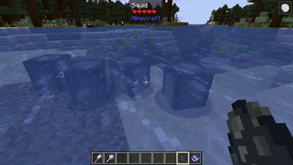
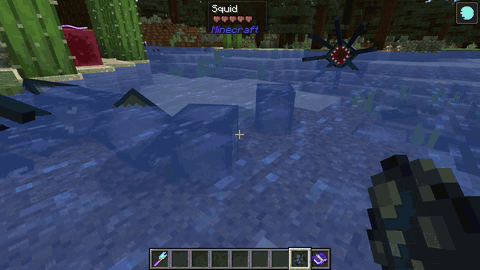
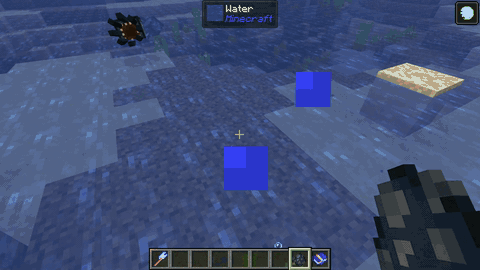
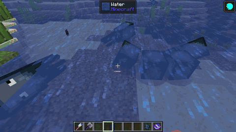

# Elements & Elemental Reactions

The combat mechanics of **Velorise's Staves & Elements** are governed by a specialized **Elemental Gauge Theory (EGT)** engine. When an entity is struck by an elemental spell or an imbued melee weapon, an **Aura** measured in Gauge Units (U) is applied to the target. Applying another element while an aura is active triggers an **Elemental Reaction**.

---

## The 8 Elements

<div align="center">
  <table>
    <tr>
      <td align="center"><br/><b>Pyro</b></td>
      <td align="center"><br/><b>Hydro</b></td>
      <td align="center"><br/><b>Cryo</b></td>
      <td align="center"><br/><b>Electro</b></td>
      <td align="center"><br/><b>Dendro</b></td>
      <td align="center"><br/><b>Anemo</b></td>
      <td align="center"><br/><b>Geo</b></td>
      <td align="center"><br/><b>Omni</b></td>
    </tr>
  </table>
</div>

* **Pyro:** Fire-based destructive energy that ignites entities, burns foliage, and triggers Vaporize, Melt, and Burgeon.
* **Hydro:** Water-based energy that wets targets and provides the foundation for Vaporize, Frozen, Electro-Charged, and Bloom.
* **Cryo:** Frost energy that slows movement, turns surface water into temporary frost, and freezes wet targets solid.
* **Electro:** High-voltage lightning energy that paralyzes targets, conducts through water bodies, and activates Dendro Cores into Hyperbloom missiles.
* **Dendro:** Organic vitality that germinates explosive botanical cores when interacting with water.
* **Anemo:** Kinetic vortex energy that pulls entities together and swirls existing auras outward to nearby targets.
* **Geo:** Earth energy that forms protective crystalline shields, summons solid pillars, and shatters frozen entities.
* **Omni:** Primordial essence capable of cycling dynamically through all elemental forms.

---

## Multiplicative Reactions

Multiplicative reactions scale directly with the trigger attack's base damage, multiplying the final damage dealt by a fixed ratio.

| Reaction | Trigger Combination | Damage Multiplier | Aura Consumption | Mechanism |
| :--- | :--- | :---: | :---: | :--- |
| **Forward Vaporize** | Hydro applied to an active Pyro aura | **2.0x (200%)** | 2.0x Gauge | Douses the flame in a violent steam eruption, consuming the underlying Pyro aura completely. |
| **Reverse Vaporize** | Pyro applied to an active Hydro aura | **1.5x (150%)** | 0.5x Gauge | Flash-boils the target while consuming only half the underlying Hydro aura gauge. |
| **Forward Melt** | Pyro applied to an active Cryo aura | **2.0x (200%)** | 2.0x Gauge | Rapidly liquefies the ice layer, resulting in extreme thermal shock damage. |
| **Reverse Melt** | Cryo applied to an active Pyro aura | **1.5x (150%)** | 0.5x Gauge | Extinguishes the flame gradually under chilling frost. |

<div align="center">
  
</div>

---

## Transformative & Crowd Control Reactions

| Reaction | Elements Involved | In-Game Effect |
| :--- | :--- | :--- |
| **Frozen** | Hydro + Cryo | Completely immobilizes the target in an ice block for several seconds. Mobs cannot move, turn, or attack while frozen. |
| **Shatter** | Heavy Melee / Geo hit on a Frozen target | Breaches the ice block prematurely, dealing heavy blunt physical damage scaling with weapon mass and tier. |
| **Electro-Charged** | Hydro + Electro | Electrifies the wet target, dealing continuous lightning damage over time while arcing electrical bolts to all nearby wet entities. Both auras co-exist on the target. |
| **Overloaded** | Pyro + Electro | Triggers a localized explosive detonation that deals Pyro damage and knocks light entities backwards, interrupting attacks. |
| **Superconduct** | Cryo + Electro | Causes a localized frost explosion that inflicts **-40% Physical Resistance Shred** on the target for several seconds, significantly boosting sword damage. |
| **Burning** | Pyro + Dendro | Ignites a persistent botanical fire that burns the entity continuously until the Dendro aura is consumed. |
| **Swirl** | Anemo + (Pyro / Hydro / Cryo / Electro) | Absorbs the target's active elemental aura and expels it outward in an expanding vortex, propagating the aura to all surrounding enemies. |
| **Crystallize** | Geo + (Pyro / Hydro / Cryo / Electro) | Dislodges an **Elemental Crystallize Shard** upon impact. Walking over the shard equips a protective elemental barrier matching the reacted element. |
| **Overvape** | Pyro on (Hydro & Electro co-existing aura) | Simultaneously triggers both Vaporize and Overloaded in a single devastating explosion. |

<div align="center">
  
  <br/><sub><i>Electro-Charged reaction chaining through multiple wet entities in a rainy environment.</i></sub>
</div>

---

## Dendro Reaction System

Dendro reactions center around the production and manipulation of **Dendro Cores**:

```
                  ┌──(Hydro)──> [ Dendro Core Entity ]
                  │                     │
[Dendro Target] ──┤                     ├──(Electro)──> Hyperbloom (Homing missile)
                  │                     │
                  │                     └──(Pyro)─────> Burgeon (High AOE explosion)
                  │
                  └──(Electro)─> [ Quicken State ] ──┬──(Electro)──> Aggravate (+Flat Electro)
                                                      └──(Dendro)───> Spread (+Flat Dendro)
```

* **Bloom:** When Hydro meets Dendro, a botanical **Dendro Core** drops onto the ground. If left untouched, the core detonates after 6 seconds, dealing moderate area-of-effect Dendro damage.
* **Hyperbloom:** Striking an existing Dendro Core with an Electro attack transforms it into a high-speed tracking projectile that locks onto the nearest hostile mob.
* **Burgeon:** Striking an existing Dendro Core with a Pyro attack triggers an instantaneous fiery explosion that inflicts heavy area-of-effect damage without damaging environmental terrain.
* **Quicken, Aggravate & Spread:** Applying Electro to a Dendro-afflicted target places the entity into a vulnerable **Quicken** state. Subsequent Electro attacks trigger **Aggravate** (added flat damage), while subsequent Dendro attacks trigger **Spread** (amplified Dendro burst).

<div align="center">
  <table>
    <tr>
      <td align="center"><b>Bloom Reaction</b><br/></td>
      <td align="center"><b>Hyperbloom Reaction</b><br/></td>
    </tr>
  </table>
</div>

---

## Elemental Resonance (Team Buffs)

When carrying 2 or more staves of the same element in your inventory (or 4 unique elements), the **Elemental Resonance** engine activates passive bonuses:

* **Pyro Resonance (Fervor):** Increases overall attack damage by 15%.
* **Hydro Resonance (Soothing Water):** Increases maximum health and incoming healing by 25%.
* **Cryo Resonance (Shattering Ice):** Increases critical strike damage and freeze duration on chilled targets.
* **Electro Resonance (High Voltage):** Generates bonus energy particles and reduces staff cooldowns.
* **Anemo Resonance (Impetuous Winds):** Decreases staff cooldowns by 5% and increases movement speed by 10%.
* **Geo Resonance (Enduring Rock):** Increases shield strength by 15% and increases damage dealt while protected by a shield.
* **Dendro Resonance (Sprawling Greenery):** Grants bonus Elemental Mastery to amplify reaction damage.
* **Protective Canopy (4 Unique Elements):** All Elemental Resistances +15% and Physical Resistance +15%.
