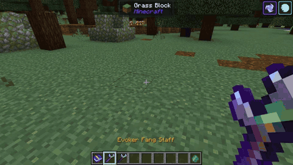
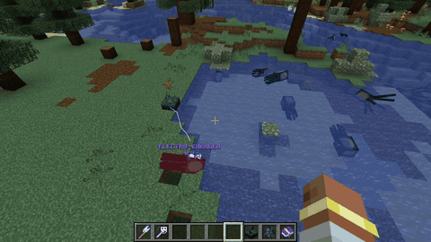

# Environmental Interactions

Unlike conventional magic mods where spells exist only as isolated projectiles, **Velorise's Staves & Elements** seamlessly links its elemental logic with Minecraft's physical environment.

---

## 1. Electrified Water

  
  &nbsp;&nbsp;&nbsp;&nbsp;<b>+</b>&nbsp;&nbsp;&nbsp;&nbsp;
  

* **Mechanism:** Discharging an Electro attack (such as the  **Arc Caster**, the  **Dragonfire Scepter**, or an Electro-imbued sword) into a water body electrifies surrounding water blocks for 120 ticks (6 seconds).
* **Effect:** All entities submerged or wading in that water body—including zombies, drowned, aquatic life, and the player—receive continuous electrical damage ticks and movement stutter.
* **Tactical Application:** Lure swarms of enemies into swamps, rivers, or rainstorms, then discharge lightning from the shoreline to electrocute the entire pack safely.

---

## 2. Temporary Frost Walking

* **Mechanism:** Firing a Cryo spell (such as the  **Frostbolt Wand**) directly at a water surface converts top-layer water blocks into temporary frosted ice sheets (radius 1 for Basic, radius 2 for Netherite).
* **Terrain Safety:** The frost lasts long enough for players to sprint or leap across rivers and ocean straits. After a short duration, the frosted ice naturally melts back into regular water, leaving the landscape completely unaltered.

---

## 3. Geo Constructs & Fang Pillars

* **Mechanism:** Casting the  **Evoker Fang Staff** summons 9 (Basic) or 13 (Netherite) biting fangs along with a solid **Geo Fang Pillar** (HP equal to 1x creator's Max HP).
* **Properties:**
  * Pulses 3m square Geo shockwaves (0.5♥, 0.5U Geo) every 2 seconds.
  * Draws enemy hostility, intercepts hostile projectiles, and blocks melee pathways.
  * If cast beneath your feet, the pillar lifts you into the air, safely elevating you out of reach from melee mobs and Creepers.

  
   <i>Summoning a Geo pillar beneath the player to evade ground-level threats and scale terrain.</i>

---

## 4. Sculk Sensor & Deep Dark Resonance

  
  &nbsp;&nbsp;&nbsp;&nbsp;<b>+</b>&nbsp;&nbsp;&nbsp;&nbsp;
  

* Deep within the subterranean Deep Dark biome, **Sculk Sensors** are acutely sensitive to arcane vibrations and sonic frequencies.
* Discharging a sonic boom from the **Resonant Echo** staff or firing lightning near a Sculk block causes the sensor to vibrate violently, activating remote redstone mechanisms and propagating shock currents to nearby mobs.

  
   <i>Remotely triggering Sculk sensors through sonic frequencies to cascade electrical pulses.</i>

