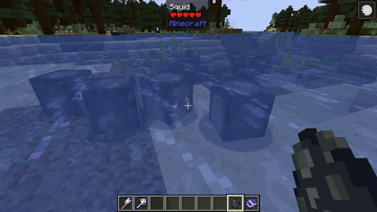
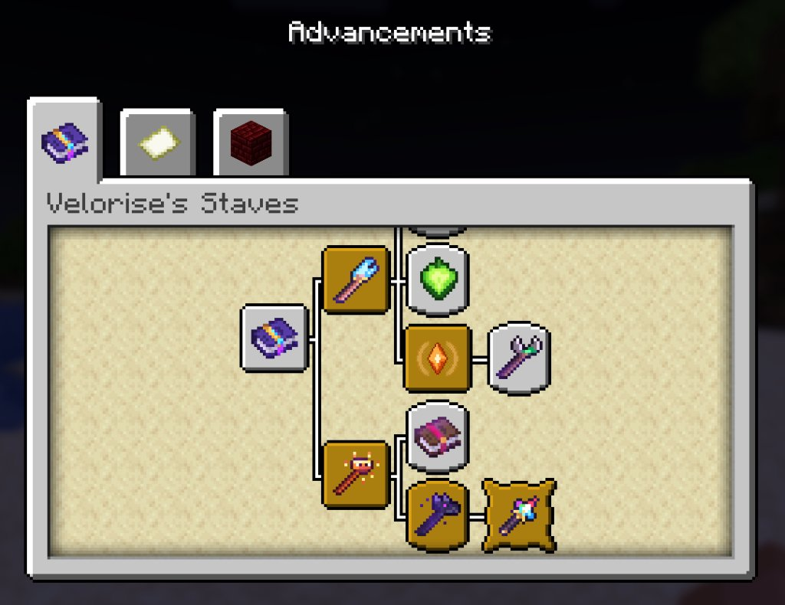
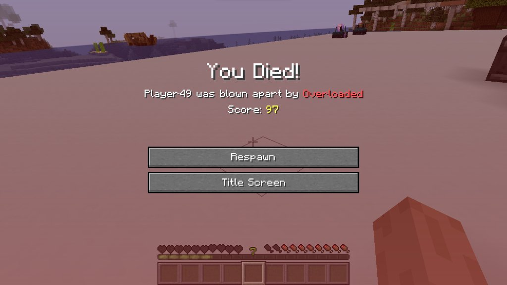

# Velorise's Staves & Elements Documentation

  
  
<i>A dynamic, environment-interactive elemental combat and magic framework for Minecraft.</i>

  

    
    
    
  

---

## Overview

**Velorise's Staves & Elements** transforms combat in Minecraft from basic sword spamming into an intricate, responsive elemental magic system inspired by *Genshin Impact* and modern Action-RPGs.

Instead of generic magic projectiles that simply apply flat damage or vanilla potion effects, Velorise's Staves implements a full **Elemental Gauge Theory (EGT)** engine:

* **7 Arcane Elements + Omni Essence:**  Pyro,  Hydro,  Cryo,  Electro,  Dendro,  Anemo,  Geo, and  Omni.
* **16 Elemental Reactions:** Multiplicative amplification (Forward/Reverse Vaporize, Forward/Reverse Melt), crowd control (Frozen, Shatter), cascading area shocks (Electro-Charged, Overloaded, Overvape, Superconduct), organic seed chains (Bloom, Hyperbloom, Burgeon, Quicken, Aggravate, Spread, Burning), and trigger effects (Swirl, Crystallize).
* **13 Distinct Arcane Staves (+ Netherite Upgrades):** Each with dedicated projectile types, sequential burst combos, charging phases, or continuous channeled beams—with full 13-staff parity across **NeoForge 1.21.1**, **Fabric 1.21.1**, and **Forge 1.20.1** (including backported Wind Staff, Breeze Rod, and throwable Wind Charge on 1.20.1).
* **8-Type Elemental Resonance & 4-Staff Cap:** Unlock passive elemental team buffs when carrying matching staves, balanced by the **Arcane Overload** inventory cap.
* **Anvil Weapon Imbuing & Staff Repair:** Infuse standard swords (Wood through Netherite, plus modded `SwordItem`s) with elemental essences on an anvil for **3 XP levels** to trigger `1.0U` aura applications on full-strength melee strikes (`>= 90%` charge), or repair staves directly with matching Elemental Essences.
* **Physical World & Gear Interactions:** Electrify water pools, build automated Redstone Tesla Coils, mine Amethyst Clusters via Overloaded blasts, freeze water into frosted ice bridges, summon Geo Fang Pillars, reflect elements with `Thorns` armor, and trigger Swirl with `Wind Burst` Maces.

---

## Quick Start Guide

  
   <i>Applying Hydro to wet an enemy, followed by a Pyro strike to trigger a Vaporize multiplier.</i>

### Step 1: Collecting Elemental Essences
Defeat hostile mobs that naturally channel elemental properties (**5% fixed drop chance** on player kill, no Looting scaling), hostile mobs with innate mutations (**7% spawn chance** = 6% Elemental + 1% Omni; **15% fixed drop chance**), or rare Omni-mutated mobs (**25% fixed drop chance**). *(Note: Split medium/tiny Slimes and Magma Cubes are excluded from dropping essences).*

* **Pyro Element:**  Dropped by Blazes, Magma Cubes (large), Ghasts, Wither Skeletons, Zombified Piglins & Zoglins.
* **Hydro Element:**  Dropped by Drowned, Guardians & Elder Guardians.
* **Cryo Element:**  Dropped by Strays (and Cryo-mutated hostiles; Snow Golems & Polar Bears also carry innate Cryo).
* **Electro Element:**  Dropped by Shulkers, Endermen, Endermites, Charged Creepers & Ender Dragons.
* **Anemo Element:**  Dropped by Breezes, Phantoms & Vexes. Can also be crafted into **4x Wind Charges** (shapeless) or combined with **1x Blaze Rod** into **1x Breeze Rod**!
* **Dendro Element:**  Dropped by Bogged, Cave Spiders & large Slimes (Bees & Mooshrooms also carry innate Dendro).
* **Geo Element:**  Dropped by Geo-mutated hostile mobs (Armadillos & Iron Golems also carry innate Geo).
* **Omni Element:**  Dropped by rare Omni-mutated mobs (**25% drop rate**) or crafted shapelessly from all **7 Elemental Essences**.

### Step 2: Crafting Your First Staff
Combine crafting ingredients in a Crafting Table:
* **Frostbolt Wand (Cryo):** 1 Blue Ice + 2 Blaze Rods placed diagonally.
* **Inferno Rod (Pyro):** 1 Fire Charge + 2 Blaze Rods placed diagonally.
* **Arc Caster (Electro):** 1 Electro Element + 2 Amethyst Shards placed diagonally.

### Step 3: Using the Elemental Codex
The  **Elemental Codex** is **automatically granted on first world join**, or can be crafted shapelessly with **1 Book + 1 Amethyst Shard**. Right-clicking opens a 9-tab interactive GUI (localized in **9 languages**: `en_us`, `vi_vn`, `zh_cn`, `ja_jp`, `ko_kr`, `de_de`, `es_es`, `fr_fr`, `ru_ru`) with clickable reaction links and live server config synchronization.

---

## Controls & Keybindings

| Action | Default Input | Description |
| :--- | :--- | :--- |
| **Cast Primary Spell** | `Right-Click` | Discharges the elemental projectile, sequential burst shot, or channeled beam. |
| **Charge / Channel Spell** | `Hold Right-Click` | Charged staves: **Resonant Echo** (1.5s), **Ghastfire Staff** (2.0s). Channeled beams: **Guardian Lens** (2.5s), **Arc Caster** (3.0s). |
| **Open Omni Element Wheel** | `Hold [Tab]` *(Rebindable)* | Opens the 8-sector radial Element Wheel while holding the **Omni Staff** (move mouse or click a sector, then release `[Tab]` to lock an element or select Auto Mode). |
| **Break Out of Frozen** | `Mash [Spacebar]` | Rapidly tapping Jump while encased in Frozen ice shaves **0.3s (6 ticks)** off your remaining freeze duration per press (0.15s cooldown). |
| **Recall to Bed / Spawn** | `Hold Right-Click` (Magic Mirror) | Channels for **2.5s** (default config; 15.0s cooldown) to recall back to your bed or world spawn point. |

---

## Advancements (11 Challenges & Goals) & Custom Death Messages

Track your arcane progression through **11 custom Advancements** and experience tailored elemental combat logs:

| Advancement Title | ID | Unlock Condition |
| :--- | :--- | :--- |
| **Velorise's Staves** | `velorise_staves:root` | Obtain the **Elemental Codex** (auto-granted on join or crafted). |
| **Apprentice Arcanist** | `velorise_staves:first_staff` | Craft or obtain your first elemental combat staff. |
| **Forged in Netherite** | `velorise_staves:netherite_upgrade` | Upgrade any staff or utility artifact to Netherite tier at a Smithing Table. |
| **Elemental Scholar** | `velorise_staves:elemental_mastery` | Hold any staff enchanted with **Elemental Mastery I–III**. |
| **Master of All Elements** | `velorise_staves:omni_staff` | Obtain the legendary **Omni Staff** or **Netherite Omni Staff**. |
| **Elemental Alchemy** | `velorise_staves:first_reaction` | Trigger your first Elemental Reaction in combat. |
| **Catalytic Bloom** | `velorise_staves:dendro_core` | Detonate a Dendro Core with Electro (**Hyperbloom**) or Pyro (**Burgeon**). |
| **Crystalline Aegis** | `velorise_staves:crystallize` | Pick up a **Crystallize Elemental Shard** to gain a 15s elemental Absorption shield. |
| **Tectonic Resonance** | `velorise_staves:geo_construct` | Summon a **Geo Fang Pillar** using the Evoker Fang Staff. |
| **High-Voltage Architect** | `velorise_staves:tesla_coil` | Activate or overcharge a Redstone **Tesla Coil** (Lightning Rod atop a Redstone Block). |
| **Spatial Riftwalker** | `velorise_staves:spatial_traveler` | Blink using the **Void Translocator** or recall home with the **Magic Mirror**. |

  <table>
    <tr>
      <td align="center"><b>Advancements Tree</b>  <i>Dedicated advancement tab guiding players through essence harvesting, staff forging, and mastering reactions.</i></td>
      <td align="center"><b>Custom Reaction Death Messages</b>  <i>Unique death messages for all elemental reactions and innate/mutated mob kills (e.g. "blown apart by Overloaded", "shattered to pieces by Shatter").</i></td>
    </tr>
  </table>

---

## Wiki Directory

* **[Elements & Reactions](Elements-and-Reactions)**: Complete breakdown of all 16 reactions, EGT gauge math (0.8x Aura Tax, decay inheritance, simultaneous priority), 8 Elemental Resonances, Innate/Mutated mobs, and Potion/Trident/Mace/Thorns synergies.
* **[Staves & Weapons](Staves-List)**: In-depth stats, burst/channeling mechanics, repair materials, and crafting recipes for all 13 staves and their Netherite upgrades.
* **[Anvil Weapon Imbuing](Anvil-Imbuing)**: Guide to infusing swords with elemental properties at an anvil, full-charge strike rules, and Fire Aspect interactions.
* **[Environmental Interactions](Environmental-Interactions)**: Details on electrified water, frost walking, Geo Fang Pillars, Sculk & Calibrated Sculk sensors, Redstone/Observer hazards, Amethyst Overloaded mining, and Mob Hazard Avoidance AI.
* **[Relics & Utilities](Relics-and-Utilities)**: Documentation for the Magic Mirror, Void Translocator, Elemental Codex, 8 Elemental Essences, and Crystallize Shields.
* **[Configuration Guide](Configuration-Guide)**: Complete reference for `velorise_staves.toml`, in-game Config GUI, live server sync, and mob mutation whitelists/blacklists.
* **[FAQ & Compatibility](FAQ-and-Compatibility)**: Multiplayer support, mod compatibility (JEI, Jade, Better Combat), and loader parity.
