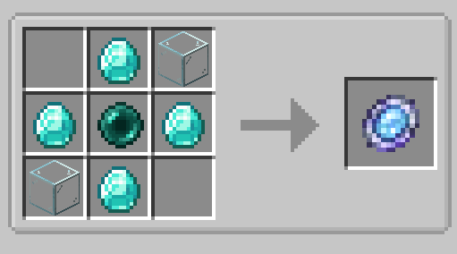
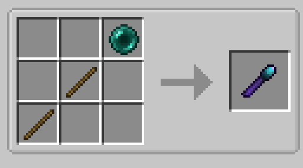
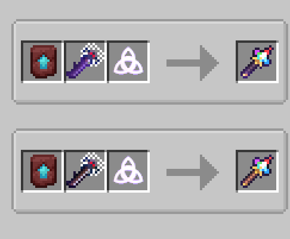
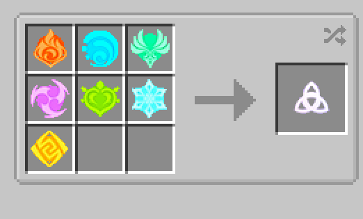
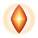
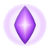

# Relics & Utility Artifacts

In addition to offensive combat staves, **Velorise's Staves & Elements** provides utility artifacts designed to streamline exploration, navigation, and defensive survival.

---

## Magic Mirror

  
  &nbsp;&nbsp;&nbsp;&nbsp;&nbsp;&nbsp;
  
   
  <b>Magic Mirror (Basic) &nbsp;|&nbsp; Netherite Magic Mirror (Ascended)</b>

* **Primary Function:** Provides an instantaneous recall mechanic back to your bed or world spawn point.
  * Hold **Right-Click** for 2.5 seconds (or 1.0s for Netherite) to channel recall energy.
  * Transports the player directly to their established spawn point, accompanied by custom audio cues and portal particle spirals.
* **Durability & Repair:**
  * **Basic Tier:** 40 uses. Repaired at an anvil using Diamonds. Recalls within the current dimension.
  * **Netherite Tier:** 150 uses. Repaired using Netherite Ingots. Enables cross-dimensional teleportation (teleporting from the Nether or The End directly back to your Overworld spawn bed).
* **Crafting Recipe:**
  * Shaped: 1 Ender Pearl (center), 4 Diamonds (cross), 2 Glass (corners).

  

---

## Void Translocator

  
  &nbsp;&nbsp;&nbsp;&nbsp;&nbsp;&nbsp;
  
   
  <b>Void Translocator (Basic) &nbsp;|&nbsp; Netherite Void Translocator (Ascended)</b>

* **Primary Function:** An instantaneous directional blink teleportation tool.
  * Right-click while looking forward to blink instantly to the targeted block surface in your line of sight.
  * **Basic Tier:** 24.0 block reach, 80 durability.
  * **Netherite Tier:** 36.0 block reach, 250 durability.
  * **Cooldown:** 5.0 seconds.
* **Mechanics:**
  * Resets fall distance to 0, ensuring **zero fall damage** upon landing.
  * Self-inflicts a mild Electro charge on the caster (1.0U Basic / 1.5U Netherite) upon blink discharge.
* **Crafting Recipe:**
  * Shaped: 1 Ender Pearl + 2 Sticks placed diagonally.

  

---

## Elemental Codex

  

* **Crafting Recipe:** **1 Book + 1 Amethyst Shard** placed anywhere in a Crafting Table (shapeless recipe).
* **In-Game Feature:** Right-clicking opens an illuminated in-game reference codex displaying the full elemental wheel, active reaction multipliers, and craftable recipes without requiring players to consult external web browsers.

  

---

## Omni Element

  

* **Primary Function:** The ultimate catalyst used in Smithing Table transformations to synthesize the Omni Staff or repair any elemental weapon.
* **Crafting Recipe:** Combine all **7 Elemental Essences** (Pyro, Hydro, Cryo, Electro, Dendro, Anemo, Geo) in any Crafting Table (shapeless recipe).

  

---

## Crystallize Shield Shards

  
  
  
  

* Produced whenever a Geo attack strikes an entity afflicted with Pyro, Hydro, Electro, or Cryo.
* Walking over a dropped shard equips an orbiting crystalline shield matching the reacted element:
  * **Pyro Shard:** Absorbs incoming fire damage.
  * **Hydro Shard:** Dampens projectile and aquatic damage.
  * **Electro Shard:** Absorbs lightning and electrical damage.
  * **Cryo Shard:** Nullifies freezing and chilling slowdowns.
