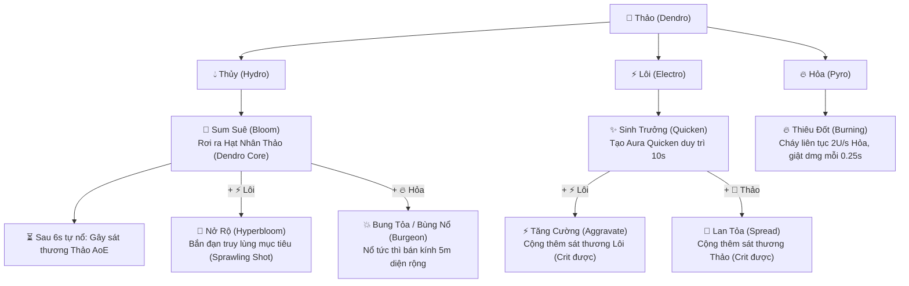

# TÀI LIỆU QUY CHUẨN TOÀN BỘ PHẢN ỨNG NGUYÊN TỐ GENSHIN IMPACT (EGT SPEC)

> **Tài liệu tham chiếu chuẩn cho dự án:** Velorise's Staves  
> **Nguồn dữ liệu đối chiếu:** KeqingMains Theorycrafting Library (KQM), Genshin Impact Wiki (Fandom), HoYoLAB Official Mechanics.  
> **Mục tiêu:** Quy chuẩn hóa 100% công thức, chỉ số Gauge Unit (GU), cây phản ứng Thảo (Bloom / Hyperbloom / Burgeon / Quicken), phản ứng môi trường, và lộ trình lập trình thực thể Hạt Nhân Thảo trong Minecraft.

---

## MỤC LỤC
1. [Hệ Thống 7 Nguyên Tố & Lý Thuyết Elemental Gauge Theory (EGT)](#1-lý-thuyết-elemental-gauge-theory-egt)
2. [Cây Phản Ứng Hệ Thảo (Dendro Reaction Tree) — Trọng Tâm](#2-cây-phản-ứng-hệ-thảo-dendro-reaction-tree)
   - 2.1. Phản ứng Sum Suê (Bloom) & Cơ chế Hạt Nhân Thảo (Dendro Core)
   - 2.2. Phản ứng Nở Rộ (Hyperbloom)
   - 2.3. Phản ứng Bung Tỏa / Bùng Nổ (Burgeon)
   - 2.4. Phản ứng Sinh Trưởng (Quicken) & Tăng Cường (Aggravate) / Lan Tỏa (Spread)
   - 2.5. Phản ứng Thiêu Đốt (Burning)
3. [Chi Tiết Toàn Bộ Các Phản Ứng Nguyên Tố Khác](#3-toàn-bộ-các-phản-ứng-nguyên-tố-khác)
   - 3.1. Nhóm Khuyếch Đại (Amplifying): Bốc Hơi (Vaporize) & Tan Chảy (Melt)
   - 3.2. Nhóm Biến Hóa (Transformative): Điện Cảm, Quá Tải, Siêu Dẫn, Đóng Băng, Phá Băng
   - 3.3. Nhóm Khuếch Tán (Swirl) & Kết Tinh (Crystallize)
4. [Bảng Tra Cứu Tỉ Lệ Tiêu Thụ Gauge & Thời Gian Phân Rã](#4-bảng-tra-cứu-tỉ-lệ-tiêu-thụ-gauge)
5. [Quy Tắc Tương Tác Môi Trường (Environmental Interaction)](#5-quy-tắc-tương-tác-môi-trường)
6. [Phân Tích Hiện Trạng Mod `velorise_staves` & Giải Pháp Kỹ Thuật](#6-phân-tích-hiện-trạng-mod-và-giải-pháp)

---

## 1. LÝ THUYẾT ELEMENTAL GAUGE THEORY (EGT)

Hệ thống chiến đấu của Genshin Impact không dùng các phép cộng trừ đơn giản, mà quản lý nguyên tố thông qua **Đơn Vị Đo Nguyên Tố (Gauge Units - ký hiệu U)**:

```
[Đòn Đánh Nguyên Tố] 
        │
        ▼
   Có sẵn Ấn nền?
   ├── CHƯA CÓ ──► Gắn Ấn Nền (Aura): Chịu Aura Tax 0.8x (1U -> 0.8U; 2U -> 1.6U)
   │               Bắt đầu đếm ngược thời gian phân rã (Decay).
   │
   └── ĐÃ CÓ   ──► Kích hoạt Phản Ứng (Reaction): Đòn đánh trở thành Kích Hoạt (Trigger).
                   Tiêu thụ lượng ấn nền theo hệ số: Aura_Mới = Aura_Cũ - (Trigger_U * Modifier)
```

### Các quy tắc bất biến của EGT:
1. **Aura Tax (Thuế ấn 0.8x):** Bất kỳ nguyên tố nào gắn lên người quái làm ấn nền đều bị hao hụt 20% lượng U ban đầu:
   - Đòn `1U` (Đòn yếu) $\rightarrow$ Ấn nền thực tế là `0.8U` (tồn tại 9.5s).
   - Đòn `2U` (Đòn vừa) $\rightarrow$ Ấn nền thực tế là `1.6U` (tồn tại 12.0s).
   - Đòn `4U` (Đòn mạnh) $\rightarrow$ Ấn nền thực tế là `3.2U` (tồn tại 17.0s).
2. **Trigger không chịu thuế (No Tax for Trigger):** Đòn đánh đóng vai trò Trigger luôn dùng **100% nguyên bản Gauge Unit** để trừ vào Aura.
3. **Phong (Anemo) và Nham (Geo) KHÔNG THỂ LÀM ẤN NỀN:** Chúng chỉ có thể đóng vai trò làm Trigger để kích hoạt Khuếch Tán (Swirl) hoặc Kết Tinh (Crystallize).

---

## 2. CÂY PHẢN ỨNG HỆ THẢO (DENDRO REACTION TREE)

Hệ Thảo là hệ phức tạp nhất trong Genshin với cấu trúc phân nhánh 2 tầng:



---

### 2.1. Phản ứng Sum Suê (Bloom) & Hạt Nhân Thảo (Dendro Core)

* **Công thức kích hoạt:**
  $$\text{Dendro} + \text{Hydro} \longrightarrow \text{Dendro Core (Hạt Nhân Thảo)}$$
* **Tỉ lệ tiêu thụ Gauge:**
  - **Forward Bloom (Thảo đánh vào Thủy):** Hệ số tiêu thụ là `2.0x`. 1U Thảo nuốt trọn 2.0U Thủy $\rightarrow$ Thủy bị xóa sạch, có thể thừa Thảo.
  - **Reverse Bloom (Thủy đánh vào Thảo):** Hệ số tiêu thụ là `0.5x`. 1U Thủy chỉ tiêu thụ 0.5U Thảo $\rightarrow$ Ấn Thảo vẫn còn tồn lưu trên người quái!
* **Quy tắc Hạt Nhân Thảo (Dendro Core):**
  1. **Xuất hiện vật lý:** Khi phản ứng xảy ra, một Hạt Nhân Thảo (khối mầm xanh lục phát sáng) rơi xuống mặt đất tại vị trí va chạm.
  2. **Số lượng tối đa:** Tối đa **5 Hạt Nhân Thảo** tồn tại đồng thời trên sân. Nếu hạt thứ 6 xuất hiện, hạt cũ nhất sẽ lập tức phát nổ.
  3. **Thời gian tồn tại:** Hạt tồn tại trong **6 giây (120 ticks)**. Nếu không có nguyên tố Hỏa/Lôi tác động, sau 6 giây hạt tự nổ gây sát thương Thảo AoE trong bán kính 3m.
  4. **Tự gây sát thương (Self-damage):** Vụ nổ của Bloom và Burgeon gây 5% sát thương lên chính người chơi nếu đứng trong bán kính nổ.

---

### 2.2. Phản ứng Nở Rộ (Hyperbloom)

* **Công thức:**
  $$\text{Dendro Core (Hạt Nhân Thảo)} + \text{Electro (Đòn Lôi)} \longrightarrow \text{Hyperbloom}$$
* **Cơ chế hoạt động:**
  - Khi đòn đánh hệ Lôi (như tia sét, cầu điện) chạm vào Hạt Nhân Thảo trên mặt đất:
  - Hạt Nhân Thảo lập tức biến đổi thành một **Tia Đạn Dẫn Đường (Sprawling Shot)** màu tím-xanh.
  - Viên đạn tự động khóa và bay lao thẳng (homing) vào kẻ địch gần nhất với tốc độ cực cao.
  - Khi trúng đích: Gây sát thương Thảo cực mạnh (hệ số sát thương $3.0\times$ so với Bloom gốc).

---

### 2.3. Phản ứng Bung Tỏa / Bùng Nổ (Burgeon)

* **Công thức:**
  $$\text{Dendro Core (Hạt Nhân Thảo)} + \text{Pyro (Đòn Hỏa)} \longrightarrow \text{Burgeon}$$
* **Cơ chế hoạt động:**
  - Khi đòn đánh hệ Hỏa chạm vào Hạt Nhân Thảo trên mặt đất:
  - Hạt Nhân Thảo **phát nổ ngay lập tức**, tạo ra một làn sóng xung kích lửa xanh rộng lớn (bán kính 5.0m).
  - Gây sát thương Thảo diện rộng diện tích lớn (hệ số sát thương $3.0\times$).

---

### 2.4. Phản ứng Sinh Trưởng (Quicken) & Tăng Cường (Aggravate) / Lan Tỏa (Spread)

* **Bước 1 — Sinh Trưởng (Quicken):**
  $$\text{Dendro} + \text{Electro} \longrightarrow \text{Quicken Aura}$$
  - Phản ứng tiêu thụ Dendro và Electro theo tỉ lệ `1:1`.
  - Không gây sát thương trực tiếp ngay lúc này.
  - Gắn lên người quái vật trạng thái **Quicken (Sinh Trưởng)** biểu hiện bằng ánh sáng vàng-xanh, tồn tại trong khoảng 9 - 11 giây.
* **Bước 2A — Tăng Cường (Aggravate):**
  $$\text{Quicken Aura} + \text{Electro (Đòn Lôi)} \longrightarrow \text{Aggravate (+ Sát thương Lôi)}$$
  - Đòn Lôi đánh vào quái đang dính Quicken sẽ được **cộng thêm sát thương cơ bản (Flat Damage Bonus)** trực tiếp. Đòn đánh này **có thể Bạo Kích (Critical Hit)**!
  - Ấn Quicken **không bị tiêu thụ mất**, vẫn còn nguyên trên người quái để nhận thêm nhiều đòn đánh tiếp theo.
* **Bước 2B — Lan Tỏa (Spread):**
  $$\text{Quicken Aura} + \text{Dendro (Đòn Thảo)} \longrightarrow \text{Spread (+ Sát thương Thảo)}$$
  - Đòn Thảo đánh vào quái đang dính Quicken sẽ được cộng thêm sát thương cơ bản Thảo (hệ số nhân cao hơn Aggravate khoảng 1.15x) và cũng có thể Bạo Kích.

---

### 2.5. Phản ứng Thiêu Đốt (Burning)

* **Công thức:**
  $$\text{Dendro} + \text{Pyro} \longrightarrow \text{Burning}$$
* **Cơ chế:**
  - Tạo ra ấn **Burning Aura (2.0U Pyro)** liên tục bốc cháy.
  - Gây sát thương Hỏa liên tục mỗi **0.25 giây** (mỗi 5 ticks Minecraft) lên mục tiêu và bất kỳ sinh vật nào đứng sát cạnh (0.8m).
  - Ngọn lửa tiêu thụ 0.4U Thảo mỗi giây cho tới khi hết ấn Thảo mới tắt.

---

## 3. TOÀN BỘ CÁC PHẢN ỨNG NGUYÊN TỐ KHÁC

### 3.1. Nhóm Khuyếch Đại (Amplifying Reactions)
Nhân trực tiếp sát thương của đòn đánh kích hoạt:

| Tên Phản Ứng | Chiều Phản Ứng | Hệ Số Sát Thương | Hệ Số Tiêu Thụ Gauge | Mô Tả |
| :--- | :--- | :--- | :--- | :--- |
| **Bốc Hơi Thuận (Forward Vaporize)** | Thủy đánh vào ấn Hỏa | **$\times 2.0$ DMG** | $2.0\times$ (Tiêu thụ mạnh) | Đòn Thủy dập tắt sạch ấn Hỏa, sát thương gấp đôi. |
| **Bốc Hơi Nghịch (Reverse Vaporize)** | Hỏa đánh vào ấn Thủy | **$\times 1.5$ DMG** | $0.5\times$ (Tiêu thụ yếu) | Đòn Hỏa chỉ hao 1 nửa ấn Thủy, ấn Thủy vẫn còn lưu lại. |
| **Tan Chảy Thuận (Forward Melt)** | Hỏa đánh vào ấn Băng | **$\times 2.0$ DMG** | $2.0\times$ (Tiêu thụ mạnh) | Lửa nung chảy băng, sát thương gấp đôi. |
| **Tan Chảy Nghịch (Reverse Melt)** | Băng đánh vào ấn Hỏa | **$\times 1.5$ DMG** | $0.5\times$ (Tiêu thụ yếu) | Băng làm mát lửa, sát thương 1.5x, ấn Hỏa còn lưu lại. |

---

### 3.2. Nhóm Biến Hóa (Transformative Reactions)

| Tên Phản Ứng | Nguyên Tố Kết Hợp | Hiệu Ứng Cơ Học & Sát Thương |
| :--- | :--- | :--- |
| **Quá Tải (Overloaded)** | $\text{Hỏa} + \text{Lôi}$ | Gây nổ Hỏa diện rộng (AoE 3.5m), hất văng mục tiêu cực mạnh (Knockback cao). |
| **Điện Cảm (Electro-Charged)** | $\text{Thủy} + \text{Lôi}$ | **Hai ấn cùng tồn tại song song (Co-existing Aura)!** Tự giật điện mỗi 1 giây (tiêu thụ 0.4U mỗi bên), gây choáng nhẹ và phóng tia sét sang các kẻ địch dính Thủy lân cận. |
| **Siêu Dẫn (Superconduct)** | $\text{Băng} + \text{Lôi}$ | Nổ Băng diện rộng (AoE 3.5m), giảm 40% kháng sát thương vật lý của mục tiêu trong 12 giây. |
| **Đóng Băng (Frozen)** | $\text{Thủy} + \text{Băng}$ | Khóa cứng hành động của mục tiêu trong 2.5s - 4s, biến quái thành khối tượng băng. |
| **Phá Băng (Shatter)** | $\text{Đòn Nặng / Nham} + \text{Frozen}$ | Đập vỡ tượng băng, gây sát thương vật lý lớn tức thì và hủy trạng thái đóng băng. |

---

### 3.3. Nhóm Khuếch Tán & Kết Tinh

* **Khuếch Tán (Swirl - Phong 🌪️):**  
  Đòn Phong đánh vào Hỏa/Thủy/Băng/Lôi $\rightarrow$ Gây sát thương nguyên tố tương ứng diện rộng và **phát tán (lan truyền)** nguyên tố đó sang toàn bộ quái vật xung quanh trong bán kính 5m!
* **Kết Tinh (Crystallize - Nham 🪨):**  
  Đòn Nham đánh vào Hỏa/Thủy/Băng/Lôi $\rightarrow$ Rơi ra một Mảnh Tinh Thể cùng hệ. Khi nhặt tạo lớp khiên hấp thụ sát thương.

---

## 4. BẢNG TRA CỨU TỈ LỆ TIÊU THỤ GAUGE (EGT CHEAT SHEET)

$$\text{Aura Còn Lại} = \text{Aura Hiện Tại} - (\text{Trigger Gauge} \times \text{Consumption Modifier})$$

| Trigger Element | Aura Element | Phản Ứng | Consumption Modifier | Aura Thường Còn Lại? |
| :--- | :--- | :--- | :---: | :---: |
| **Hydro (1U)** | Pyro (1.6U) | Forward Vaporize | **$2.0\times$** ($1.0 \times 2.0 = 2.0$U) | **HẾT (0U)** |
| **Pyro (1U)** | Hydro (1.6U) | Reverse Vaporize | **$0.5\times$** ($1.0 \times 0.5 = 0.5$U) | **CÒN (1.1U Hydro)** |
| **Pyro (1U)** | Cryo (1.6U) | Forward Melt | **$2.0\times$** ($1.0 \times 2.0 = 2.0$U) | **HẾT (0U)** |
| **Cryo (1U)** | Pyro (1.6U) | Reverse Melt | **$0.5\times$** ($1.0 \times 0.5 = 0.5$U) | **CÒN (1.1U Pyro)** |
| **Dendro (1U)** | Hydro (1.6U) | Forward Bloom | **$2.0\times$** ($1.0 \times 2.0 = 2.0$U) | **HẾT (0U)** $\rightarrow$ **Sinh Hạt Thảo** |
| **Hydro (1U)** | Dendro (1.6U) | Reverse Bloom | **$0.5\times$** ($1.0 \times 0.5 = 0.5$U) | **CÒN (1.1U Thảo)** $\rightarrow$ **Sinh Hạt Thảo** |
| **Anemo / Geo (1U)** | Bất kỳ Aura (1.6U) | Swirl / Crystallize | **$0.5\times$** ($1.0 \times 0.5 = 0.5$U) | **CÒN (1.1U Aura)** |
| **Electro / Pyro (1U)** | Quicken Aura | Aggravate / Spread | **$0.0\times$** (Không trừ U) | **NGUYÊN VẸN** |

---

## 5. QUY TẮC TƯƠNG TÁC MÔI TRƯỜNG

1. **Nước sông, biển, ao, mưa rơi:**  
   - Cấp ấn **Ẩm Ướt (Wet / Hydro 1.0U)** vô tận.
   - Bất kỳ đòn Hỏa nào đánh xuống nước $\rightarrow$ Lập tức nổ **Bốc Hơi (Vaporize)** dập tắt lửa.
   - Bất kỳ đòn Băng nào đánh xuống nước $\rightarrow$ Lập tức **Đóng Băng (Frozen)**.
   - Bất kỳ đòn Lôi nào đánh xuống nước $\rightarrow$ Lập tức **Điện Cảm (Electro-Charged)** giật sét cả vùng nước.
   - Bất kỳ đòn Thảo nào đánh xuống nước $\rightarrow$ Lập tức **Sum Suê (Bloom)**, **tạo ra Hạt Nhân Thảo (Dendro Core) nổi lềnh bềnh trên mặt nước!**
2. **Dung nham (Lava) & Lửa (Fire):**  
   - Cấp ấn **Hỏa (Pyro)** liên tục. Đòn Thủy đánh vào bốc hơi xì khói; đòn Băng đánh vào tan chảy lập tức.

---

## 6. PHÂN TÍCH HIỆN TRẠNG MOD VÀ GIẢI PHÁP

### 🔍 Giải mã bức ảnh Iron Golem dưới nước của bạn:
Trong ảnh chụp của bạn (`media_1794154057068_97a8d6e0.jpg`):
1. **Hiện tượng:** Con Iron Golem đứng ngâm chân dưới nước, khi bạn bắn đòn Thảo vào thì trên đầu nó hiện icon Thảo (Dendro), nhưng **xung quanh không có Hạt Nhân Thảo nào rơi ra**!
2. **Nguyên nhân trong code:**
   - Khi Iron Golem đứng dưới nước, hàm `applyElement` đã cấp ấn Thủy (Wet).
   - Khi đòn Thảo bắn trúng, code đã tính ra phản ứng `BLOOM`.
   - **NHƯNG:** Code hiện tại mới chỉ phát ra hiệu ứng hạt khói xanh `ParticleTypes.SPORE_BLOSSOM_AIR` và trừ máu trực tiếp, **chứ trong thế giới Minecraft chưa có một thực thể (Entity) thật sự nào tên là `DendroCoreEntity` để rơi xuống đất/nổi trên mặt nước**!
   - Do đó, người chơi nhìn vào chỉ thấy hiệu ứng hạt rồi tắt, không có hạt thảo để bắn Lôi (kích Hyperbloom) hay bắn Hỏa (kích Burgeon) theo đúng gameplay Genshin.

### 🛠️ Lộ trình triển khai Hạt Nhân Thảo (Dendro Core) hoàn chỉnh:
1. **Tạo thực thể `DendroCoreEntity`:**
   - Một thực thể nhỏ hình hạt mầm xanh phát sáng (hoặc dùng `ItemEntity` mang texture Hạt Thảo phát quang).
   - Tự động nổi trên mặt nước hoặc rơi xuống đất.
   - Sau 6 giây tự kích nổ gây sát thương Thảo AoE.
2. **Kích hoạt Hyperbloom & Burgeon thật sự:**
   - Khi người chơi dùng gậy Sét (`Stormcaller` / `Shulker Seeker`) bắn trúng hạt thảo $\rightarrow$ Hạt thảo phóng vút đi biến thành đạn homing lao vào quái (**HYPERBLOOM**).
   - Khi người chơi dùng gậy Lửa (`Dragonfire` / `Inferno` / `Ghastfire`) bắn trúng hạt thảo $\rightarrow$ Hạt thảo nổ tung diện rộng 5m (**BURGEON**).

---
*Tài liệu được tổng hợp chính xác theo quy chuẩn Mihoyo Genshin Impact Theorycrafting.*
